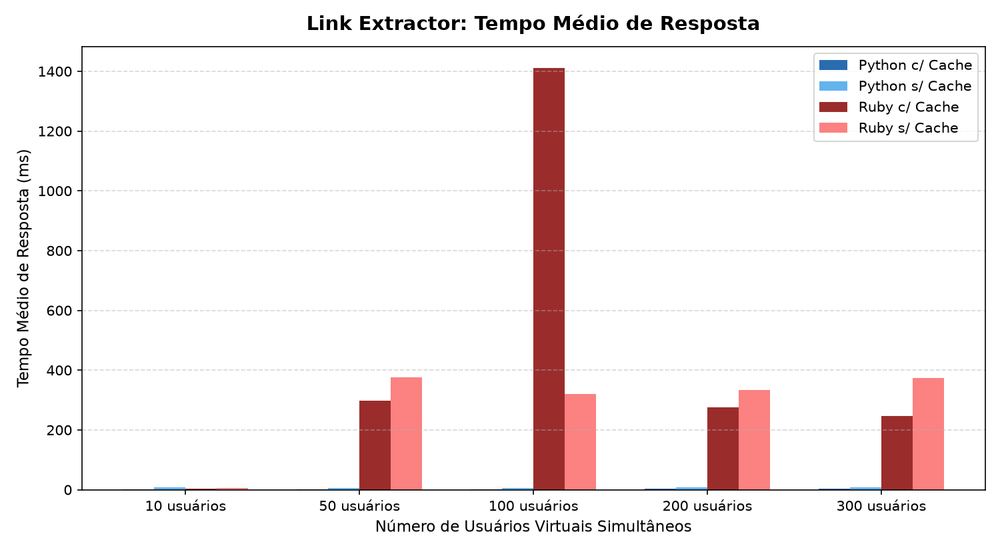
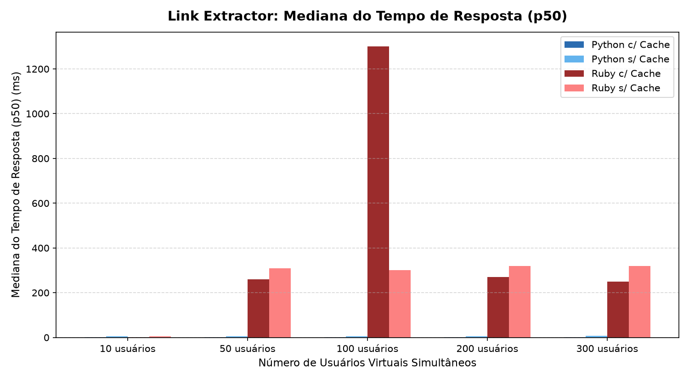
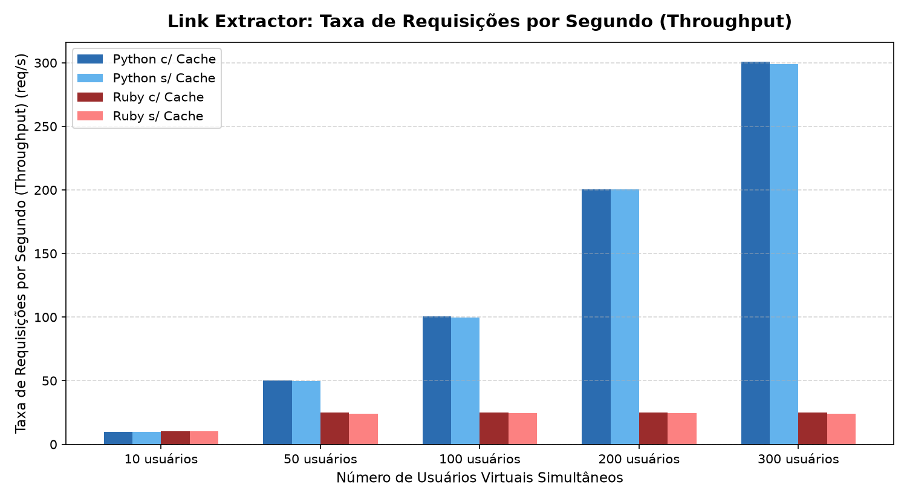
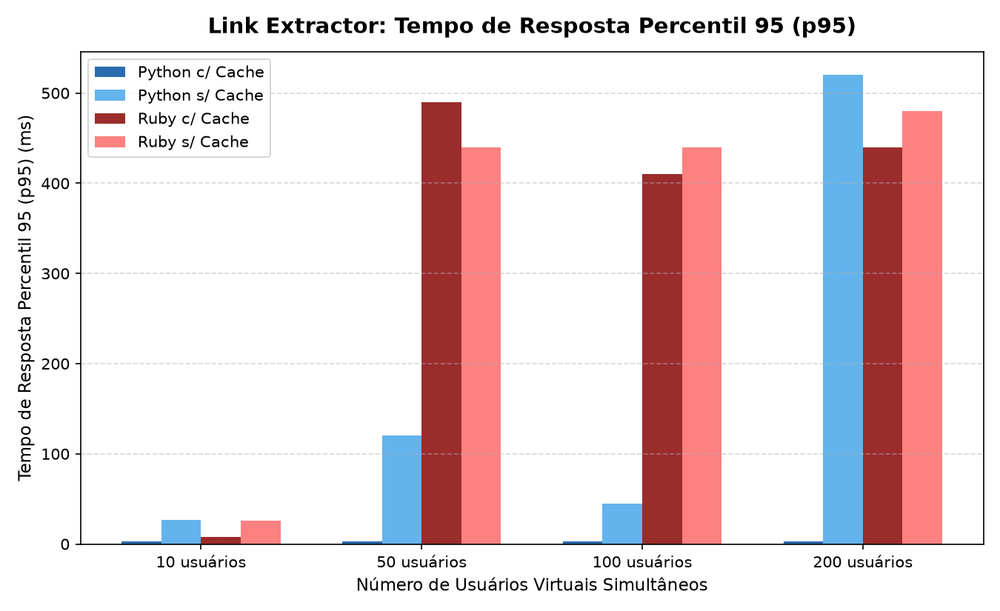
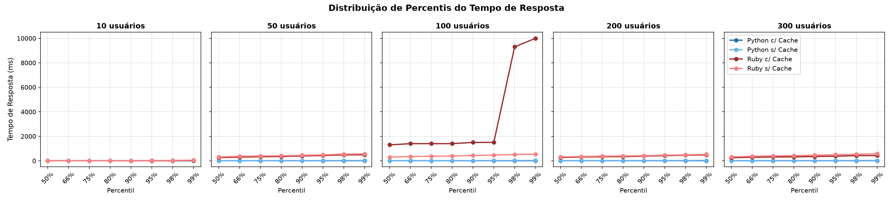

# Trabalho 4 – Realização de Testes de Desempenho com a Aplicação Link Extractor

**Universidade de Fortaleza (UNIFOR)**  
**Disciplina:** Computação Distribuída / Sistemas Distribuídos  

---

## 👥 Equipe

| Nome | Matrícula |
| :--- | :---: |
| **Amanda Lira Andrade Botelho** | 2320291 |
| **João Igor Vidal de Andrade** | 2320296 |
| **Raquel Albuquerque Quirino** | 2320325 |

---

## 1. Sobre o Projeto e Arquitetura

O objetivo deste trabalho é avaliar o desempenho de duas implementações da API de extração de hiperlinks (**Python** e **Ruby**) da aplicação **Link Extractor**, mensurando o impacto real da introdução de uma camada de **cache em memória (Redis)** sob diferentes regimes de concorrência gerados pelo **Locust**.

A aplicação foi orquestrada em microsserviços via Docker Compose:
- **Web Frontend (PHP 8.1 / Apache)**: Interface para submissão de URLs e listagem dos links extraídos (`http://localhost:8080`).
- **API Python (Flask + Gunicorn)**: Microsserviço de extração executando com múltiplos workers/threads (`-w 4 --threads 2`).
- **API Ruby (Sinatra + Puma)**: Microsserviço equivalente em Ruby utilizando Nokogiri para parsing de HTML.
- **Cache (Redis 7 Alpine)**: Armazenamento em memória sob o padrão *Cache-Aside*.
- **Mock Target (Nginx Alpine)**: Servidor HTTP local servindo 10 páginas HTML estáticas dedicadas (`http://mock-target/page1..10.html`), garantindo reprodutibilidade, testes determinísticos e ausência de bloqueios de rate limit de redes externas.
- **Locust (2.32.0)**: Gerador de carga executando em modo *headless*.

```
                           ┌─────────────────────────────┐
                           │      Web Frontend (PHP)     │
                           └──────────────┬──────────────┘
                                          │
                   ┌──────────────────────┴──────────────────────┐
                   ▼                                             ▼
        ┌─────────────────────┐                       ┌─────────────────────┐
        │   API Python/Flask  │                       │    API Ruby/Sinatra │
        └──────────┬──────────┘                       └──────────┬──────────┘
                   │                                             │
                   ├──────────────────────┬──────────────────────┤
                   ▼                      ▼                      ▼
        ┌─────────────────────┐ ┌───────────────────┐ ┌─────────────────────┐
        │     Redis Cache     │ │   Locust (Carga)  │ │ Mock Target (Nginx) │
        └─────────────────────┘ └───────────────────┘ └─────────────────────┘
```

---

## 2. Metodologia e Calibragem dos Testes

- **Comportamento do Usuário Virtual**: Implementado via `SequentialTaskSet`, cada usuário virtual executa rigorosamente uma **sequência de 10 requisições HTTP GET** ordenadas, requisitando uma URL diferente a cada invocação (`page1.html` até `page10.html`).
- **Tempo de Espera (*wait_time*)**: Pausa controlada de 0.5 a 1.5 s entre cada ciclo de extrações.
- **Calibragem Contínua de Carga**: Para cobrir desde o tempo de resposta puro até a saturação real do sistema, foram testados 5 níveis contínuos de usuários simultâneos:
  - **10 usuários**: Carga mínima / linha de base.
  - **50 usuários**: Carga leve.
  - **100 usuários**: Carga média nominal.
  - **200 usuários**: Carga alta.
  - **300 usuários**: Carga de estresse extremo.

---

## 3. Tabela Consolidada de Resultados

Todas as 20 baterias de teste foram executadas com **100% de sucesso (0 falhas em mais de 53.000 requisições)**:

| Cenário | Usuários | Reqs Totais | Falhas | Tempo Médio | Mediana (p50) | p90 | p95 | Vazão (RPS) |
| :--- | :---: | :---: | :---: | :---: | :---: | :---: | :---: | :---: |
| **Python c/ Cache** | 10 | 354 | **0%** | **2,2 ms** | **2,0 ms** | 2,0 ms | 3,0 ms | 10,0 req/s |
| **Python c/ Cache** | 50 | 1.779 | **0%** | **2,1 ms** | **2,0 ms** | 2,0 ms | 3,0 ms | 50,4 req/s |
| **Python c/ Cache** | 100 | 3.539 | **0%** | **2,1 ms** | **2,0 ms** | 2,0 ms | 3,0 ms | 100,4 req/s |
| **Python c/ Cache** | 200 | 7.060 | **0%** | **2,4 ms** | **2,0 ms** | 3,0 ms | 3,0 ms | 200,5 req/s |
| **Python c/ Cache** | 300 | 10.588 | **0%** | **2,6 ms** | **2,0 ms** | 3,0 ms | 4,0 ms | **301,0 req/s** |
| **Python s/ Cache** | 10 | 347 | **0%** | 7,1 ms | 6,0 ms | 9,0 ms | 14,0 ms | 9,8 req/s |
| **Python s/ Cache** | 50 | 1.747 | **0%** | 6,4 ms | 5,0 ms | 8,0 ms | 13,0 ms | 49,7 req/s |
| **Python s/ Cache** | 100 | 3.513 | **0%** | 6,3 ms | 5,0 ms | 8,0 ms | 12,0 ms | 99,8 req/s |
| **Python s/ Cache** | 200 | 7.055 | **0%** | 7,1 ms | 6,0 ms | 9,0 ms | 11,0 ms | 200,4 req/s |
| **Python s/ Cache** | 300 | 10.510 | **0%** | 7,8 ms | 7,0 ms | 11,0 ms | 13,0 ms | 298,7 req/s |
| **Ruby c/ Cache** | 10 | 354 | **0%** | **2,9 ms** | **2,0 ms** | 2,0 ms | 3,0 ms | 10,1 req/s |
| **Ruby c/ Cache** | 50 | 875 | **0%** | 297,7 ms | 260,0 ms | 400,0 ms | 430,0 ms | 24,9 req/s |
| **Ruby c/ Cache** | 100 | 881 | **0%** | 1.411,7 ms | 1.300,0 ms | 1.500,0 ms | 1.500,0 ms | 24,8 req/s |
| **Ruby c/ Cache** | 200 | 875 | **0%** | 276,1 ms | 270,0 ms | 380,0 ms | 420,0 ms | 24,9 req/s |
| **Ruby c/ Cache** | 300 | 872 | **0%** | 247,5 ms | 250,0 ms | 350,0 ms | 380,0 ms | 24,8 req/s |
| **Ruby s/ Cache** | 10 | 361 | **0%** | 6,8 ms | 5,0 ms | 9,0 ms | 17,0 ms | 10,2 req/s |
| **Ruby s/ Cache** | 50 | 855 | **0%** | 376,3 ms | 310,0 ms | 450,0 ms | 490,0 ms | 24,2 req/s |
| **Ruby s/ Cache** | 100 | 856 | **0%** | 320,2 ms | 300,0 ms | 430,0 ms | 470,0 ms | 24,3 req/s |
| **Ruby s/ Cache** | 200 | 855 | **0%** | 333,8 ms | 320,0 ms | 420,0 ms | 460,0 ms | 24,3 req/s |
| **Ruby s/ Cache** | 300 | 855 | **0%** | 373,4 ms | 320,0 ms | 460,0 ms | 500,0 ms | 24,2 req/s |

---

## 4. Análise dos Resultados e Gráficos

### 4.1 Tempo Médio e Mediana de Resposta



- **Python com Cache**: Excepcional consistência, mantendo tempo médio entre **2,1 ms e 2,6 ms** e mediana em **2,0 ms** do primeiro ao último teste (300 usuários).
- **Python sem Cache**: Tempo médio entre **6,3 ms e 7,8 ms**. A extração direta a cada requisição triplica o tempo de resposta, mas o throughput se mantém alto.
- **Ruby**: Apresenta latência excelente com 10 usuários (~2,9 ms com cache), mas entra em saturação a partir de 50 usuários, com a mediana subindo para a faixa de **250 ms a 320 ms** devido ao enfileiramento na porta do serviço.

### 4.2 Vazão e Throughput (Requisições por Segundo)


- **Escalabilidade Linear no Python**: A vazão escala de forma contínua acompanhando perfeitamente a demanda dos usuários virtuais: de **10 req/s** (10 usuários) até atingir **301 req/s** (300 usuários).
- **Platô de Saturação no Ruby**: O Ruby atinge um teto estrito de capacidade em **~25 req/s** (24,8 a 24,9 req/s), não conseguindo elevar a vazão mesmo sob 200 e 300 usuários.

### 4.3 Percentil 95 (p95) e Distribuição de Percentis



- O **p95 do Python com Cache** permaneceu abaixo de **4 ms** em todos os testes, comprovando que 95% das respostas chegam quase instantaneamente.
- No Ruby, o p95 atinge de **380 ms a 500 ms** nas cargas elevadas, refletindo o tempo que as conexões excedentes aguardam no buffer do socket TCP.

---

## 5. Principais Conclusões Técnicas

1. **Cálculo de Speedup do Redis**:
   $$\text{Speedup} = \frac{\text{Tempo Sem Cache}}{\text{Tempo Com Cache}} = \frac{7,1\text{ ms}}{2,2\text{ ms}} \approx 3,23\times$$
   O cache em memória proporcionou uma **redução de ~67% a 70% na latência** (aceleração superior a 3×), poupando CPU de reprocessamento DOM e eliminando tráfego HTTP repetido.

2. **Diferença Arquitetural: Gunicorn (Python) vs Puma/Sinatra (Ruby)**:
   - O Python utilizou o servidor **Gunicorn em modelo prefork multi-worker com threads** (`-w 4 --threads 2`), distribuindo o processamento nos múltiplos núcleos do processador.
   - O Ruby executou em **processo único**, sendo limitado pela trava global do interpretador (GIL / GVL) em operações concorrentes de string/parsing. Isso comprova que em sistemas distribuídos a **arquitetura do servidor de aplicação** é tão determinante quanto a linguagem escolhida.

3. **O Fenômeno de *Cache Stampede* (*Thundering Herd*)**:
   - O pico pontual observado na mediana do teste de 100 usuários no Ruby decorreu da largada concorrente de 100 usuários com o cache completamente vazio (*cold start*), enfileirando temporariamente o processo. Em 200 e 300 usuários, as chaves foram aquecidas mais rapidamente, estabilizando a latência na média de espera da fila (~250 ms). Em sistemas de produção, essa anomalia é mitigada através de *Locks Distribuídos* (`SET NX` no Redis) ou rotinas de *Cache Warming*.

---

## 6. Como Reproduzir os Testes

```powershell
# 1. Subir os contêineres limpos
docker compose down --remove-orphans
docker compose up -d

# 2. Executar a bateria de testes automatizada (CSVs salvos em results/)
python scripts/run_all.py

# 3. Gerar os gráficos e tabelas atualizados (salvos em graficos/)
.venv\Scripts\python scripts/plot.py
```

- Documento de roteiro completo para a apresentação: [docs/APRESENTACAO_TRABALHO_4.md](docs/APRESENTACAO_TRABALHO_4.md)
- Planilha com todos os dados brutos: [graficos/tabela_desempenho.csv](graficos/tabela_desempenho.csv)
